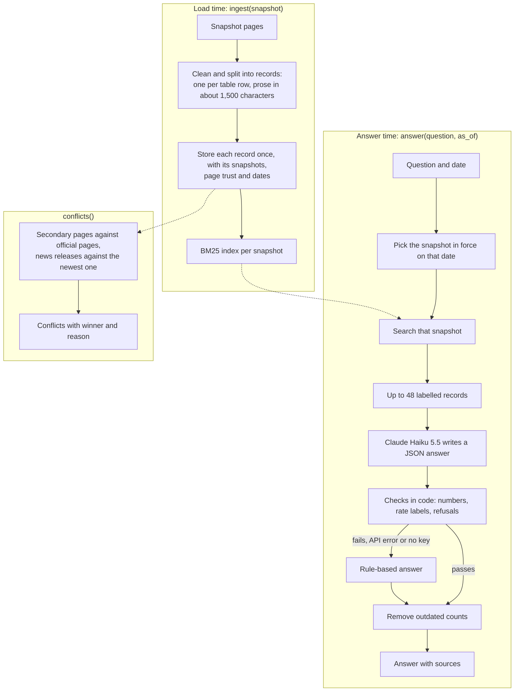

# Notes

## How it works

The system answers questions about the credit union from the five website snapshots, using only what was current on the date asked.
Every answer that states a fact cites the pages it came from, and when the snapshots do not say, the system refuses instead of guessing.

**At load time** (`ingest`), every page is cleaned and split into records.
Each table row is one record that keeps its column headers and the "effective as of" date printed by the table; prose is cut into pieces of about 1,500 characters.
Each record is stored once, with the snapshots it appeared in, how far its page can be trusted, and the publication date of news and blog posts.
A BM25 keyword index is built for each snapshot, so no indexing happens while answering.

**At answer time** (`answer`), the system picks the snapshot in force on the question's date, searches it, and gives up to 48 labelled records to Claude Haiku 5.5, which returns a JSON answer naming the records it used.
Code then checks that answer: every number must appear in the records, and a rate labelled APY or APR must be one, corrected from its table row when the model mislabels it.
An answer that says the value is missing, or answers a rate question without giving a rate, becomes a refusal.
If a number or label cannot be backed by the records, the API fails, or no key is set, a rule-based answerer answers instead, so the system always returns an answer.
Reader answers are cached by snapshot and question, and rule-based answers are deterministic, so asking again gives the same answer.
A refusal is one fixed sentence with no numbers, marked `confident=False`.

**Conflicts** (`conflicts`) are found in the newest snapshot, of three kinds: a rate table on a secondary page (promotion, landing page, calculator) that differs from the official table for the same product and tier; a rate stated in a sentence on a secondary page that differs from it; and a fact repeated in news-release boilerplate, such as the branch count, where the newest release wins.
Each stale table or page is reported once, with the winning value and the reason.
Answers use the same rules (next section): an outdated count is removed from answers in code, and no answer in our runs gave a value that `conflicts()` calls outdated.



## How we decide what's current

1. **The date picks the snapshot.** Without `as_of`, the newest snapshot answers. With `as_of`, the latest snapshot taken on or before that date answers; a date before the first snapshot is refused.
2. **The official page beats secondary copies.** The home, contact, rates and product pages are official; promotions, landing pages, calculators, news releases and blog posts are secondary. When they disagree, the official page wins. A value found only on a secondary page is still given, with a note that the page may be outdated.
3. **The later effective date wins** among official pages that disagree.
4. **The newest dated page wins** for a fact repeated across dated pages, such as the branch count in news releases.
5. **Ended offers are never current.** A promotion described as ended or expired is ignored.

A different tier, term, model year or product is a different fact, never a conflict.
The model never chooses the snapshot: it only sees records from the snapshot in force on the question's date, each labelled official or secondary with its dates.
`conflicts()` and the rule-based answerer apply these rules in code.
The reader is given the same rules with those labels, and code then removes any answer sentence that repeats an outdated count; no answer in our runs repeated an outdated value.

## API keys and paid services

- `ANTHROPIC_API_KEY` is optional. It turns on the model reader, and it is the same key the kit's `--judge` option uses.
- The reader uses Claude Haiku 5.5, which is a **paid API**: one call per question of about 10,000 input tokens, so about $0.001 per question, or 4 cents for the 40 public questions.
- Without the key, or without the `anthropic` package, the system answers with rules only and makes no network calls.
- If the API is slow or fails, each call times out after 10 seconds and is retried once, and the question is then answered by rules; after 3 failures in a row the reader stops calling the API for the rest of the run.
- `KNOWLEDGE_READER=off` forces rules only even when the key is set.
- No other API or service is used.

---

## More detail

### Running it

From the repo root:

```bash
pip install -r requirements.txt
```

```bash
python harness/run_eval.py --submission solution --eval eval/public_eval.jsonl
```

Set `ANTHROPIC_API_KEY` in the environment to turn on the reader.
Add `--conflicts-gold experiments/eval_sets/conflicts_gold.json` to also score `conflicts()` against the 8 contradictions we found by hand.
The snapshots are not in this repository; place the kit's `snapshots_zip/` next to `harness/` and the runner unpacks them on the first run.
The solution is in `solution/` (entry point `solution.py`); `experiments/` holds the variants and scripts used to compare alternatives.

### Results

Accuracy (`qa_score`) from the kit's runner, over two full runs of the final code:

| | Public 40 | Reworded 40 | Held-out 21 | Held-out 16 | Blind 32 |
|---|---|---|---|---|---|
| Rules only (no key) | 0.748 | 0.577 | 0.769 | 0.813 | 0.478 |
| With the reader | 0.941 | 0.934 to 0.947 | 1.000 | 1.000 | 0.970 to 1.000 |

Reworded asks each public question in other words; the two held-out sets cover products and dates the public set does not; blind covers topics we had not looked at.
The public set is the kit's; the other sets were written by us and every expected value was checked against the snapshots (`experiments/eval_sets/`), so they show how the system does beyond the public questions, but do not predict the hidden score.
The blind set scored 0.925 on its first run, before we looked at its questions; two misses found there were then fixed, which gives the later 0.970 to 1.000.
Ranges are over the two runs, since the model's wording varies slightly between runs.
In both runs, all 14 questions across the sets that should be refused were refused, no answer repeated an outdated value, and `conflicts()` found exactly the 8 contradictions we had found by hand, and nothing else.
The kit's own paraphrase pairs in the public set always gave the same values; adding our rewordings, a public question and its rewording agreed in 38 of 40 pairs, and a repeated question always got the same answer.
Three public questions lose points:
- Volunteer Time Off is lost on purpose: the kit expects 294 (the 2023 figure), while the newest release gives 256 for 2024, and the answer follows the newest page.
- "The rate for the certificate of accounts" has no required values in the kit, so it scores 0 without `--judge`, though the answer lists every certificate rate.
- Lobby hours loses only the source credit, since the pages the kit expects do not list hours.

Over the 298 answers of both runs, the median answer took 1.0 second and the 95th percentile 1.6 seconds, under the kit's 2-second mark; one answer took over 2 seconds.
Rules-only answers take about 0.01 seconds.

### Known limits

- Full quality needs the paid key: rules alone score 0.748 on the public set and 0.478 on new topics.
- The 95th-percentile answer time is close to the kit's 2-second mark; the longest answers (full lists of branch hours) take longest to generate and can pass it when the API is slow.
- A repeated question gets the same answer within a run, but a few answers vary between runs, for example whether the Forbes answer says it was the fifth recognition.
- Search is by keywords, so a question worded very differently from the site can rank the right page lower; embedding search was tested and scored lower on both the public and the reworded questions, so it is not used.
- Branch hours appear only in the news releases announcing a branch (7 releases, 2021 to 2024), since the site has no hours page; hours are known for those branches only, and as they were announced.
